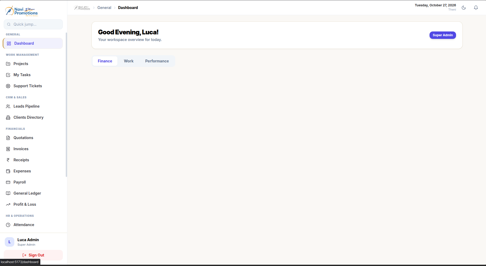
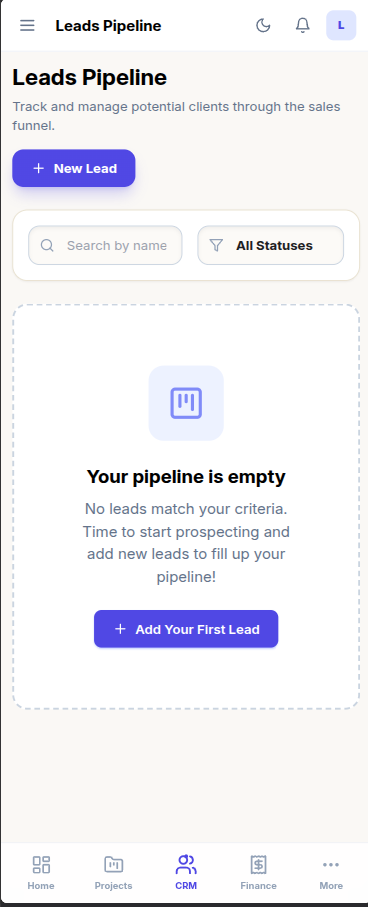
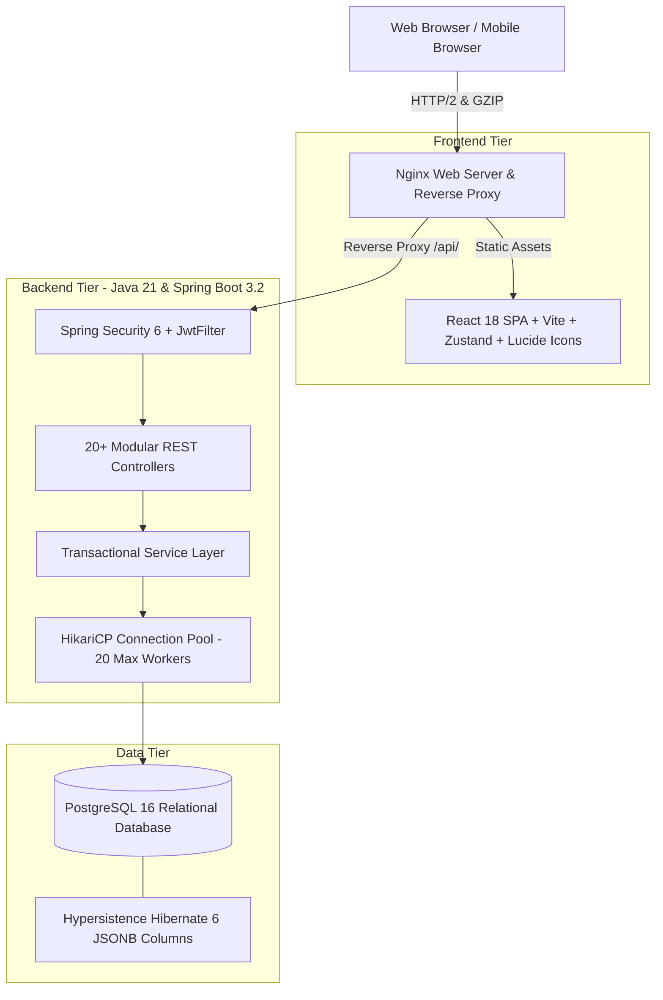

<div align="center">

# ⚡ LUCA CRM & Enterprise WorkSpace
### An Enterprise Business ERP, Financial Double-Entry Accounting & Resource Management Platform

[](https://spring.io/projects/spring-boot)
[](https://www.oracle.com/java/)
[](https://reactjs.org/)
[](https://vitejs.dev/)
[](https://tailwindcss.com/)
[](https://www.postgresql.org/)
[](https://www.docker.com/)
[](#)

<p align="center">
  <b>A unified, high-throughput ERP operating system designed to replace fragmented SaaS tools for creative agencies and enterprise teams.</b>
</p>

</div>

---

## 📸 Preview & Screenshots

<div align="center">

### 🖥️ Desktop Enterprise Dashboard


<br/>

### 📱 Mobile Responsive Experience (CRM Pipeline)


</div>

---

## 🌟 Key Highlights & Business Capabilities

LUCA CRM & Enterprise WorkSpace eliminates SaaS sprawl by consolidating customer pipelines, delivery operations, payroll calculation, and double-entry bookkeeping into a single coherent interface:

| Domain | Key Capabilities |
| :--- | :--- |
| **🔐 Auth & RBAC** | Stateless JWT authentication, Refresh Token rotation (15m / 7d), BCrypt encryption, and role-based access levels (`Super Admin`, `Admin`, `Finance`, `HR`, `Employee`). |
| **🎯 CRM Pipeline** | Complete sales funnel tracking: Ingestion, stage qualification, client directory, service catalog linking, and dynamic quotation builder. |
| **💼 Work Management** | Project milestones, task assignments with state machine workflows, team workload monitoring, and client support ticketing. |
| **💰 Financials & Ledger** | Invoicing lifecycle (Draft/Sent/Paid), receipts reconciliation, expense categorization, reimbursement approvals, and double-entry General Ledger balance sheets. |
| **👥 HRMS & People Ops** | Clock-in/Clock-out attendance tracking, automated leave quota deductions, holiday schedules, and automated month-end payroll generation (Gross, Deductions, Net). |
| **🛡️ Password Vault** | Internal team credential isolation and encrypted secret storage with role-gated access control. |

---

## 🏗️ Architecture & High-Level System Design



---

## 🛠️ Tech Stack & Technical Implementation

### **Backend Engine**
- **Language**: **Java 21 (LTS)** leveraging modern concurrency and records for DTOs.
- **Framework**: **Spring Boot 3.2.4** (Spring MVC, Spring Data JPA, Spring Security 6).
- **Security**: Stateless **JJWT (0.12.5)** with short-lived access tokens and refresh token rotation.
- **Database**: **PostgreSQL 16** with **Hibernate 6** and `hypersistence-utils` for native JSONB mapping.
- **Performance**:
  - **HikariCP** pool tuning (`maximum-pool-size: 20`, `min-idle: 5`).
  - **Hibernate Batching**: `jdbc.batch_size: 20` and `order_inserts: true` for bulk writes.
  - **HTTP/2 & GZIP**: Compression enabled for JSON payloads > 1KB.

### **Frontend Interface**
- **Core**: **React 18.2** with **Vite 5.2** for sub-second Hot Module Replacement (HMR).
- **Styling**: **TailwindCSS 3.4** with unified dark/light themes and custom glassmorphism styles.
- **State Management**: **Zustand** for lightweight, non-blocking global store (auth, session, UI state).
- **Icons & Visuals**: **Lucide React** & **Recharts** for real-time dashboards and operational metrics.
- **Resilience**: Axios interceptors with silent token refresh on `401 Unauthorized` responses.

---

## 🚀 Quick Start (Run with Docker)

The easiest way to spin up the entire ecosystem (Database, Spring Boot backend, and React frontend) is using Docker Compose:

### Prerequisites
- [Docker](https://docs.docker.com/get-docker/) & [Docker Compose](https://docs.docker.com/compose/) installed.

### 1. Clone the Repository
```bash
git clone https://github.com/KGobikrishnan/LUCA-CRM-Workspace.git
cd LUCA-CRM-Workspace
```

### 2. Environment Setup
Copy the sample environment file:
```bash
cp .env.example .env
```

### 3. Launch All Services
```bash
docker compose up -d --build
```

### 4. Access the Application
- 🌐 **Frontend Application**: [http://localhost:3000](http://localhost:3000)
- 🔌 **Backend REST API**: [http://localhost:8080/api](http://localhost:8080/api)
- 🗄️ **PostgreSQL Port**: `localhost:5432`

---

## 💻 Local Development (Without Docker)

### 1. Backend Setup
```bash
cd backend

# Build and run with Maven (Java 21 required)
mvn spring-boot:run
```
*Backend starts on `http://localhost:8080`*

### 2. Frontend Setup
```bash
cd frontend

# Install dependencies and start Vite dev server
npm install
npm run dev
```
*Frontend starts on `http://localhost:5173` with proxy pass configured to backend.*

---

## 📁 Repository Structure

```text
├── backend/                       # Spring Boot 3.2 Java application
│   ├── deployment/                # Systemd service & Nginx production configs
│   ├── src/
│   │   ├── main/java/com/navipromo/workspace/
│   │   │   ├── config/            # Web and CORS configuration
│   │   │   ├── controller/        # 20+ REST API controllers
│   │   │   ├── dto/               # Strongly-typed Data Transfer Objects
│   │   │   ├── entity/            # JPA Domain entities
│   │   │   ├── repository/        # Spring Data JPA repositories
│   │   │   ├── security/          # Spring Security, JwtFilter, JwtUtil
│   │   │   └── service/           # Transactional business logic
│   │   └── main/resources/        # application.yml configuration
│   ├── Dockerfile                 # Multi-stage Java 21 build
│   └── pom.xml                    # Maven dependencies
├── frontend/                      # React 18 + Vite frontend
│   ├── src/
│   │   ├── components/            # Reusable UI component library
│   │   ├── pages/                 # CRM, Financials, HR, Projects, Auth pages
│   │   ├── services/              # Axios instance & API client modules
│   │   ├── store/                 # Zustand global state stores
│   │   └── utils/                 # Formatting & helper utilities
│   ├── nginx.conf                 # Container reverse proxy configuration
│   ├── Dockerfile                 # Multi-stage Vite + Nginx build
│   └── package.json               # Node dependencies
├── screenshots/                   # Application screenshots for GitHub
├── docker-compose.yml             # Full-stack Docker orchestration
├── .env.example                   # Environment variable template
└── README.md                      # Project documentation
```

---

## 🔒 Security & Data Protection
- **No Hardcoded Secrets**: Sensitive credentials and production IPs are strictly externalized via environment variables.
- **Database Dump Isolation**: Production SQL backups and SSH access dumps are excluded by root `.gitignore`.
- **Role-Gated Access**: Endpoints enforce role-based authorization ensuring data segregation across HR, Finance, and Client operations.

---

## 👨‍💻 Author & Contributions
Developed with precision by **[Gobikrishnan (Luca)](https://github.com/KGobikrishnan)**.
For queries or enterprise deployment consultation, feel free to connect!
